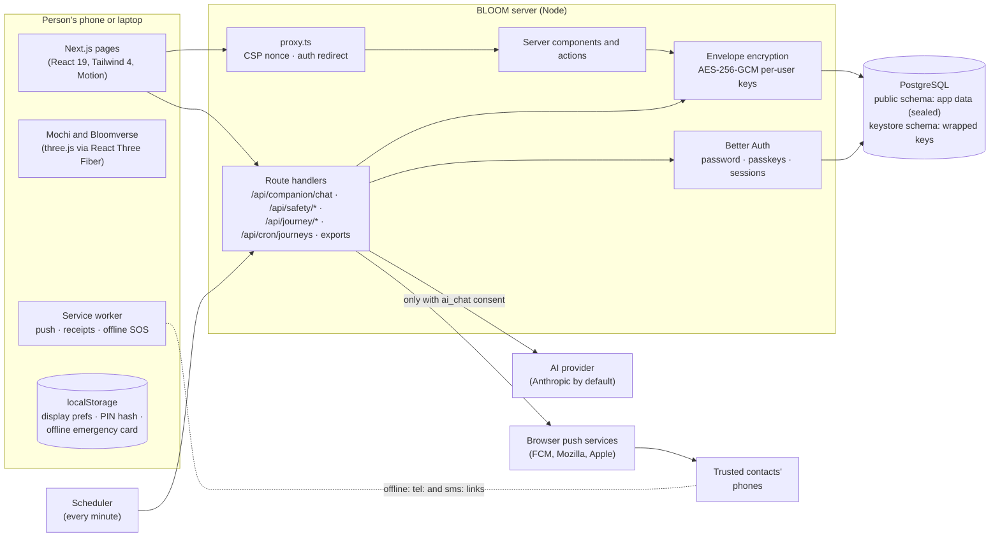
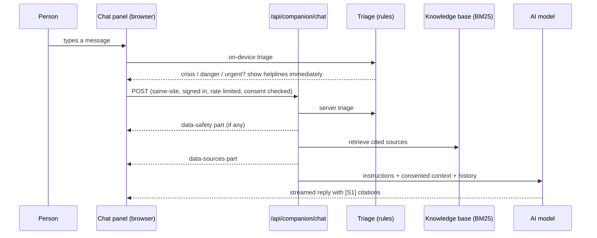
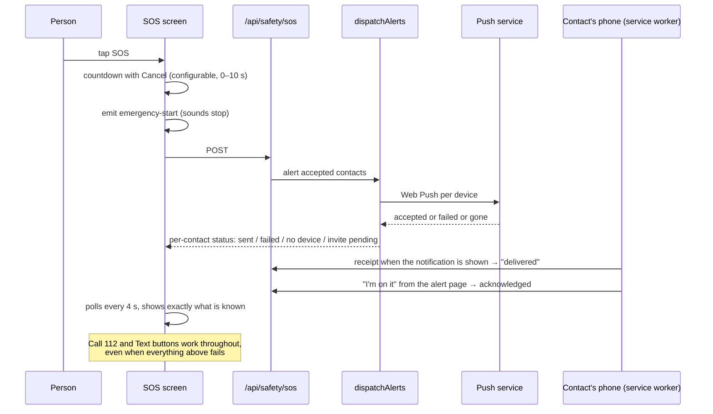
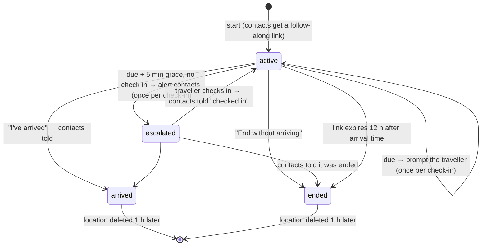

# Architecture

BLOOM is one Next.js 16 application (App Router, React 19, TypeScript). It talks to one PostgreSQL database. There are no separate services: server components read data directly, server actions handle form-style changes, and a small number of route handlers serve browsers, service workers and schedulers.

## Principles the code follows

- **Nothing pretends.** Mochi's replies come from a real model or Mochi says the AI isn't connected. SOS statuses come from push-service responses and device receipts, never from optimism. Predictions carry their uncertainty.
- **Safety doesn't depend on the clever parts.** SOS works with no AI, no WebGL, no animation and no network. Triage runs on the device and on the server, independent of the model.
- **Personal data is sealed at the application layer.** The database sees ciphertext for every health, journal, contact and location payload. See [security-privacy.md](security-privacy.md).
- **Consent is per purpose and recorded.** AI chat, AI cycle context, AI memory, SOS location, journey location and mood-tinted Bloomverse each have their own switch and history.

## Main flows

### Talking to Mochi

If no provider is configured, the route sends a `data-notice` part and no reply text. The safety card and the sources still arrive.

### SOS

When there's no connection, the service worker serves `public/sos-offline.html`. It reads the emergency card from localStorage and offers `tel:` and `sms:` links with GPS coordinates.

### Journeys

A journey has an expected arrival time and optional check-ins every 10, 15 or 30 minutes. The rules are pure functions in `src/lib/safety/journey-rules.ts`:

`processJourneys` runs from the scheduler, and `processJourney` runs whenever the traveller's screen or a contact's follow-along page asks about a journey. Each successful scheduler run updates `job_heartbeat`; when it is more than 5 minutes old, the journey screens say that reminders and alerts only work while BLOOM is open. Each step claims its row with a conditional `UPDATE … RETURNING`, so overlapping runs can't send the same alert twice.

### Bloomverse

Wellness activities (breathing ≥ 60 s, mood check-ins, journal entries, cycle logs, completed goals) are recorded in `wellness_activity`. `placeFlowers` turns them into flowers deterministically: positions come from a hash of each activity id, and the oldest are placed first, so a new flower never moves an old one. Each species is one merged geometry drawn with one instanced mesh, and a vertex shader makes them sway. The soundscapes are synthesised once in an `OfflineAudioContext`, made seamless and looped, so playback doesn't depend on timers.

## Folder responsibilities

| Folder | Holds |
| --- | --- |
| `src/lib/cycle` | Day logs (sealed), period derivation, FIGO-based prediction, insights |
| `src/lib/ai` | Triage rules, knowledge base and BM25 retrieval, prompt builder, provider selection, memory, cycle context |
| `src/lib/safety` | Contacts and invites, SOS, push dispatch and receipts, journeys and their rules, devices, emergency numbers and info |
| `src/lib/wellness` | Moods, journal, goals, breathing timings, reflection prompts, activity records |
| `src/lib/garden`, `src/lib/audio` | Flower placement and sky mapping; the ambient engine and soundscape synthesis |
| `src/lib/crypto` | `seal`/`open` (AES-256-GCM), per-user key management, crypto-shredding |
| `src/lib/privacy.ts` | Full data export and account deletion |
| `src/components/*` | UI per feature; `ui/` holds the shared primitives |
